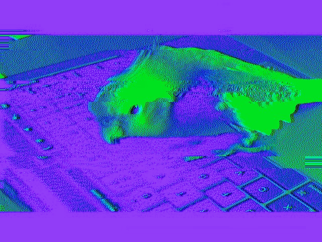



{: .about-image}

- software engineer from Budapest, mostly C++/Java, currently at BlackRock
- professionally interested in software architecture, distributed systems, complex technical problems etc.
- currently feeling a bit confused that AI coding tools changed the whole game for now
- making small games, often under game-jam time pressure (some of them even work: [projects](/projects/))
- interested in philosophy, music, architecture, films, books, art, design, gaming, politics, nutrition, ethics, and basically anything I encounter around 2 am on a random Tuesday.

bird:

